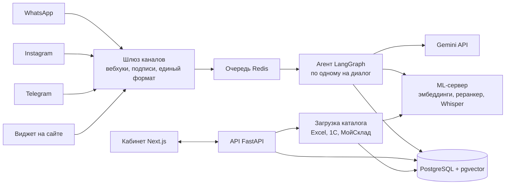
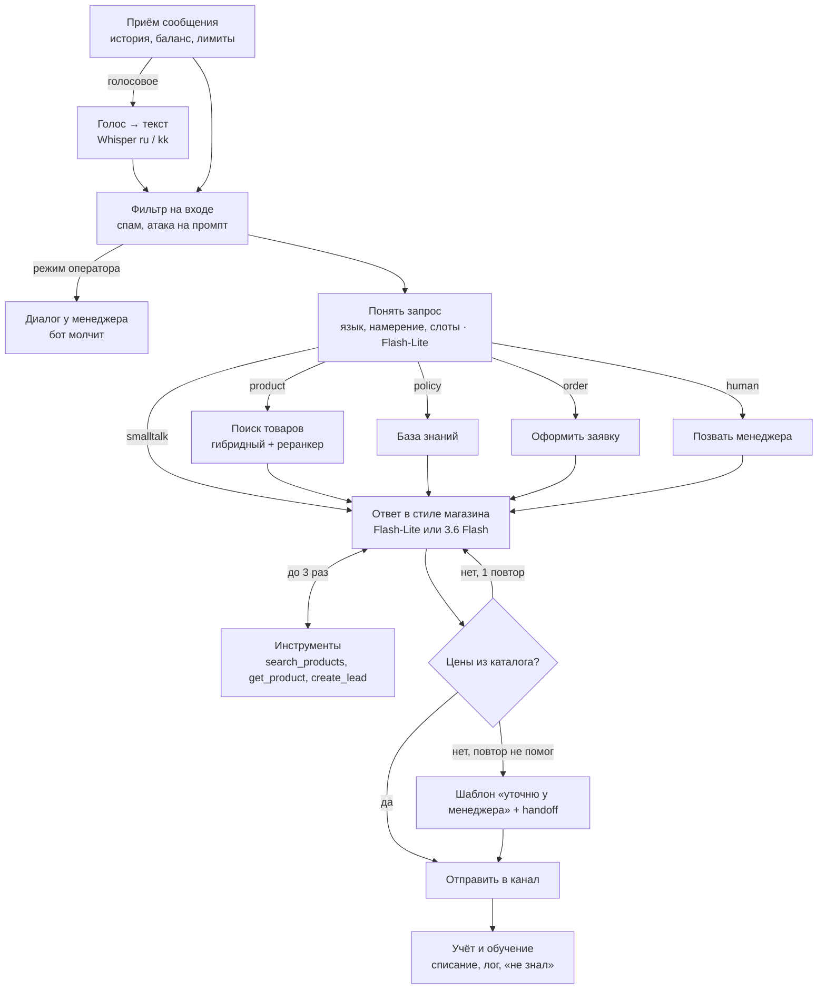

# Satushy — спецификация MVP

Nov 2, 2026 · @IsaKisa

## Глобальные правила разработки

- **НИКОГДА НЕ КООАВТОРИСЬ С КЛОДОМ.** Никаких `Co-Authored-By`, подписей и упоминаний AI в коммитах и PR.
- Сообщение коммита — короткий текст на русском, 5–7 слов, без префиксов `feat:`, `docs:`, `chore:` и т. п.
- Комментарии в коде — по минимуму, только где без них непонятно.
- Не пушить без просьбы.


## Продукт и путь клиента

Satushy (рабочее название, от каз. «сатушы» — продавец) — сервис, где магазин сам за один день запускает AI-консультанта: тот знает все товары магазина и отвечает в WhatsApp, Instagram, Telegram и на сайте. Рынок — Казахстан, языки — русский, казахский и их смесь.

**Для кого:** розница с каталогом от 50 до 50 000 позиций — цветы, автозапчасти, электроника, одежда, косметика, стройматериалы. Клиенты — ИП и ТОО.

**Путь клиента:**

1. Лендинг → регистрация по телефону или почте с кодом подтверждения.
2. Мастер настройки из пяти шагов (можно прервать и вернуться):
   1. **Бизнес.** Название, ниша, город, ссылки на Instagram, сайт, 2GIS, Kaspi. ИИ по ссылкам собирает черновик: описание магазина, тон общения, частые вопросы.
   2. **Товары.** Excel/CSV, Google Таблица, МойСклад, 1С или прайс Kaspi. ИИ предлагает сопоставление колонок, клиент подтверждает.
   3. **Характер бота.** Пресет тона плюс свои правила: доставка, оплата, скидки, когда звать менеджера, приветствие.
   4. **Песочница.** Тест-чат с ботом и автопроверка на 20 вопросах, сгенерированных из его же каталога.
   5. **Каналы.** Telegram и виджет — в один клик; Instagram и WhatsApp — по пошаговой инструкции с видео.
3. Оплата тарифа и пополнение баланса → бот включается.
4. Работа в кабинете: диалоги с перехватом менеджером, заявки, аналитика, список «бот не знал ответа», баланс.

**Роли:** владелец (всё), менеджер (диалоги и заявки), админ Satushy (мы). Первые подключения мы проводим вместе с клиентом по видеосвязи: в админке есть режим «войти как клиент» с записью в журнал действий, чтобы заполнять настройки за него.

## Архитектура и стек

Весь MVP — один сервер с Python-бэкендом и одной базой. Из внешнего только Gemini API и API самих каналов. Входящие сообщения не обрабатываются в вебхуке: шлюз сразу отвечает 200 и кладёт сообщение в очередь, иначе Meta пришлёт его повторно.



| Слой | Выбор | Почему |
| --- | --- | --- |
| Лендинг и кабинет | Next.js + Tailwind + shadcn/ui | один проект, SEO для лендинга, готовые компоненты |
| API и вебхуки | FastAPI, Pydantic | твой основной стек, асинхронно, схемы из коробки |
| Агент | LangGraph + Postgres-чекпоинтер | явный граф, память диалога, режим оператора |
| База и поиск | PostgreSQL + pgvector + pg\_trgm | товары, вектора, полнотекст и деньги в одной базе |
| Очереди | Redis + ARQ | вебхуки, загрузка каталога, исходящие сообщения, блокировки диалогов |
| Локальные модели | Text Embeddings Inference или sentence-transformers, faster-whisper | эмбеддинги, реранкер, голос без оплаты за запрос |
| Генерация | Gemini API через свою обёртку | смена модели одной настройкой |
| Файлы | S3-совместимое хранилище | прайсы, фото товаров, голосовые |
| Наблюдение | Langfuse, Sentry, Uptime Kuma | трассы и стоимость каждого ответа, ошибки, аптайм |

## Граф пайплайна бота

Ответ строится как граф LangGraph: дешёвая модель сначала понимает запрос и выбирает ветку, агент отвечает с инструментами, проверка не выпускает ответ с ценой, которой нет в каталоге. Цель — ответ быстрее 6 секунд.



Граф вместо одного большого промпта даёт три вещи: предсказуемую стоимость (дорогая модель вызывается только там, где нужна), память диалога через чекпоинты по `conversation_id` и честный режим оператора: когда диалог у менеджера, граф останавливается на фильтре. Каждый узел пишет трассу в Langfuse, поэтому видно, где теряется время и деньги.

**Каркас графа** (узлы — заглушки, структура и переходы — рабочие):

```python
from typing import Annotated, TypedDict
from langgraph.graph import StateGraph, START, END
from langgraph.graph.message import add_messages
from langgraph.checkpoint.postgres import PostgresSaver

class ChatState(TypedDict, total=False):
    tenant_id: str
    conversation_id: str
    channel: str            # whatsapp | instagram | telegram | web
    audio_url: str | None   # голосовое, если есть
    human_mode: bool        # диалог ведёт менеджер
    messages: Annotated[list, add_messages]
    lang: str               # ru | kk | mixed
    intent: str             # product | policy | order | human | smalltalk
    slots: dict             # бюджет, марка/модель, дата, артикул
    context: list           # найденные товары и куски базы знаний
    tool_hops: int
    retries: int
    check_ok: bool          # ставит guard_out
    usage: list             # токены и модель по каждому вызову

def ingest(s): ...      # история, профиль бота, баланс, лимит на покупателя
def transcribe(s): ...  # Whisper ru / kazakh-whisper kk
def guard_in(s): ...    # спам, инъекции, стоп-слова
def understand(s): ...  # Flash-Lite, structured output: lang, intent, slots
def retrieve(s): ...    # гибридный поиск + реранкер, цены из базы
def kb(s): ...          # база знаний магазина
def order(s): ...       # сбор слотов заявки
def handoff(s): ...     # human_mode=True, уведомление менеджеру
def respond(s): ...     # ответ в стиле бренда, модель по сложности
def tools(s): ...       # search_products, get_product, create_lead; tool_hops += 1
def guard_out(s): ...   # все цены и артикулы есть в context?
def fallback(s): ...    # шаблон «уточню у менеджера» + handoff
def send(s): ...        # формат под канал
def meter(s): ...       # ledger, аналитика, «не знал»

g = StateGraph(ChatState)
for name, fn in [("ingest", ingest), ("transcribe", transcribe), ("guard_in", guard_in),
                 ("understand", understand), ("retrieve", retrieve), ("kb", kb),
                 ("order", order), ("handoff", handoff), ("respond", respond),
                 ("tools", tools), ("guard_out", guard_out), ("fallback", fallback),
                 ("send", send), ("meter", meter)]:
    g.add_node(name, fn)

g.add_edge(START, "ingest")
g.add_conditional_edges("ingest", lambda s: "transcribe" if s.get("audio_url") else "guard_in")
g.add_edge("transcribe", "guard_in")
g.add_conditional_edges("guard_in", lambda s: END if s.get("human_mode") else "understand")
g.add_conditional_edges("understand", lambda s: s["intent"], {
    "product": "retrieve", "policy": "kb", "order": "order",
    "human": "handoff", "smalltalk": "respond"})
for n in ("retrieve", "kb", "order", "handoff"):
    g.add_edge(n, "respond")

def after_respond(s):
    wants_tool = bool(getattr(s["messages"][-1], "tool_calls", None))
    return "tools" if wants_tool and s.get("tool_hops", 0) < 3 else "guard_out"

g.add_conditional_edges("respond", after_respond)
g.add_edge("tools", "respond")

def after_check(s):
    if s.get("check_ok"):
        return "send"
    return "respond" if s.get("retries", 0) < 1 else "fallback"

g.add_conditional_edges("guard_out", after_check)
g.add_edge("fallback", "send")
g.add_edge("send", "meter")
g.add_edge("meter", END)

with PostgresSaver.from_conn_string(DATABASE_URL) as saver:
    saver.setup()
    app = g.compile(checkpointer=saver)
    app.invoke(incoming, config={"configurable": {"thread_id": conversation_id}})
```

Воркер держит один скомпилированный граф и берёт сообщения из очереди. Сообщения одного диалога обрабатываются по очереди (блокировка по `conversation_id` в Redis), а несколько сообщений подряд склеиваются в одно за 1,5 секунды — иначе «привет», «есть пионы?», «на сегодня» получат три отдельных ответа.

## Пайплайн загрузки каталога

Главное решение: цена и остаток живут обычными колонками и обновляются без пересчёта эмбеддингов, а в вектора идёт только описательный текст. Так бот никогда не назовёт вчерашнюю цену, а синхронизация на 50 000 товаров стоит копейки.

**Источники в MVP:** Excel/CSV, ссылка на Google Таблицу. **После пилотов:** МойСклад (REST API), 1С через стандартный обмен с сайтом (CommerceML: import.xml + offers.xml), XML-прайс Kaspi (формат проверить на реальном файле пилота).

1. **Загрузка.** Файл → объектное хранилище, задача в очередь, клиент видит прогресс.
2. **Сопоставление колонок.** Дешёвая модель смотрит заголовки и 5 строк и предлагает: название, артикул, цена, остаток, категория, описание, фото, атрибуты. Клиент подтверждает, маппинг сохраняется для следующих загрузок.
3. **Нормализация.** Цены в ₸, числа без пробелов, очистка HTML, дедупликация по артикулу, артикулы в общий вид (без дефисов и пробелов — для точного поиска OEM-номеров).
4. **Обогащение (по желанию).** Для товаров без описания модель через Batch API (скидка 50%) пишет короткое описание и поисковые синонимы на русском и казахском («колодки», «тормозные колодки», «тежегіш қалыптары»).
5. **Разделение полей.** Статичные (название, описание, атрибуты, синонимы) → текст для эмбеддинга. Динамичные (цена, остаток) → колонки.
6. **Индексация.** Хеш статичного текста → эмбеддинг считается только для новых и изменившихся товаров (pgvector). Параллельно — полнотекстовый индекс (tsvector) и триграммы для артикулов (pg\_trgm).
7. **Синхронизация.** По расписанию (15–60 минут) обновляются только цена и остаток; если изменилось описание — товар индексируется заново.
8. **Отчёт клиенту.** Загружено N, ошибки по строкам, товары без цены или фото.

**База знаний магазина** (доставка, оплата, возврат, адреса, гарантия, график) хранится отдельно: текст режется на куски по 300–500 токенов и ищется тем же гибридным поиском.

**Как ищем товар.** Три списка кандидатов — векторный поиск, полнотекстовый и точный по артикулу — сливаются методом RRF (reciprocal rank fusion), затем фильтры (в наличии, цена ≤ бюджета, категория). Топ-30 уходит в реранкер, в ответ попадает топ-5 с актуальной ценой из базы.

```latex
\mathrm{RRF}(d) = \sum_{r \in \{\text{vec},\, \text{fts},\, \text{sku}\}} \frac{1}{k + \mathrm{rank}_r(d)}, \quad k = 60
```

## Модели

Всё, что не генерирует текст, крутится на своём сервере (эмбеддинги, реранкер, распознавание голоса), а ответы пишет Gemini по API. Основная экономия — каскад: дешёвая модель отвечает по умолчанию, Gemini 3.6 Flash подключается только на сложные диалоги.

| Задача | Модель | Где | Цена / ресурс | Почему |
| --- | --- | --- | --- | --- |
| Эмбеддинги | [Qwen3-Embedding-0.6B](https://qwenlm.github.io/blog/qwen3-embedding) (1024 измерения, Apache 2.0); запасной — BGE-M3 (MIT) | свой сервер, CPU | бесплатно, \~1,5 ГБ RAM | 100+ языков, контекст 32K, MTEB multilingual 64.33 |
| Реранкер | Qwen3-Reranker-0.6B (Apache 2.0) | свой сервер | бесплатно | точность топ-5 после гибридного поиска |
| Голосовые | Whisper large-v3-turbo (русский) + [kazakh-whisper-large-v3-turbo](https://huggingface.co/shyngys879/kazakh-whisper-large-v3-turbo) (WER 11,8% на FLEURS kk) через faster-whisper | свой сервер, GPU желателен | бесплатно | покупатели часто пишут голосовыми |
| Роутер: язык, намерение, слоты | Gemini 3.1 Flash-Lite | API | $0,25 / $1,50 за 1 млн токенов | быстро и дёшево, structured output |
| Ответ по умолчанию | Gemini 3.5 Flash-Lite | API | $0,30 / $2,50 | \~80% диалогов: найти, показать, оформить |
| Сложный ответ | Gemini 3.6 Flash | API | $0,75 / $3,75, с 1 января 2027 — $1,50 / $7,50 | подбор по совместимости, длинные диалоги, возражения |
| Обогащение каталога | Gemini 3.5 Flash-Lite через Batch API | API | $0,15 / $1,25 | фоновая задача, скидка 50% |

Цены — [официальная страница Gemini API](https://aistudio.google.com/docs/pricing), стандартный тариф, вход / выход.

**Правила:**

- Все вызовы LLM идут через один свой класс-обёртку (или LiteLLM): провайдера и модель можно поменять одной настройкой — важно из-за подорожания 3.6 Flash в январе.
- Системный промпт магазина стоит первым и не меняется между сообщениями — так срабатывает неявное кэширование Gemini, и кэшированные токены стоят в 10 раз дешевле.
- Качество эмбеддингов на казахском публично не измерено. До выбора собираем свой набор из 100 запросов (русский, казахский, смесь) на каталоге пилота и сравниваем Qwen3 и BGE-M3 по Recall@10.
- Голос: язык определяет базовый Whisper, казахские голосовые уходят в дообученную модель. Пока нет GPU — запасной путь: аудио напрямую в Gemini 3.1 Flash-Lite ($0,50 за 1 млн аудио-токенов).

## Каналы

Все каналы приводятся к одному формату сообщения, поэтому бот не знает, откуда пришло письмо. WhatsApp в MVP клиент подключает сам по инструкции ниже, а счета Meta за сообщения приходят ему напрямую — нам не нужно перевыставлять их затраты.

| Канал | Как подключает клиент | Время | Что нужно от нас |
| --- | --- | --- | --- |
| Telegram | Создаёт бота в @BotFather, вставляет токен в кабинет | 5 мин | Вебхук ставим автоматически |
| Сайт | Копирует одну строку `<script>` в Tilda, WordPress или свой сайт | 5 мин | JS-виджет чата |
| Instagram | Входит через Instagram в нашем кабинете (нужен профессиональный аккаунт) | 5 мин | Наше приложение Meta с одобренным доступом к сообщениям (App Review). До одобрения пилоты работают через роль тестировщика в нашем приложении |
| WhatsApp | Создаёт своё приложение Meta и вставляет ключи в кабинет (инструкция ниже) | 30–60 мин | Помощь по видеосвязи на первых подключениях |

**Правила Meta, которые нас касаются:**

- С 15 января 2026 в WhatsApp Business API запрещены ИИ-ассистенты «общего назначения» (вроде ChatGPT). Бот при бизнесе для поддержки и продаж разрешён ([respond.io](https://respond.io/blog/whatsapp-chatbot-policy-2026)). Поэтому наш бот отвечает только про магазин, посторонние темы вежливо отклоняет и всегда умеет передать диалог человеку.
- С 1 октября 2026 ответы в окне 24 часов бесплатны только до 1 000 в месяц на номер, дальше каждое доставленное сообщение платное; без карты в WhatsApp Manager доставка может остановиться ([YCloud](https://www.ycloud.com/blog/whatsapp-api-message-pricing-update-effective-october-1-2026)). Клиент должен знать об этом до подключения.
- Оставить WhatsApp Business на телефоне и одновременно работать через API (coexistence) можно только через Embedded Signup, а для него нужен статус Tech Provider ([Meta](https://developers.facebook.com/documentation/business-messaging/whatsapp/embedded-signup/onboarding-business-app-users)). В MVP клиент подключает новый номер или переносит старый; статус Tech Provider — цель второго этапа.

### Инструкция для клиента: WhatsApp

1. **Номер.** Возьмите номер, на котором нет аккаунта WhatsApp, или удалите аккаунт в приложении на текущем номере. После подключения переписка идёт через кабинет Satushy, а не через телефон.
2. **Бизнес-портфолио.** На business.facebook.com создайте портфолио с названием как в документах ИП.
3. **Приложение.** На developers.facebook.com → My Apps → Create App → тип Business, привяжите к своему портфолио.
4. **Номер в WhatsApp.** В приложении добавьте продукт WhatsApp → API Setup → Add phone number. Введите номер и отображаемое имя магазина, подтвердите кодом из SMS или звонка.
5. **Постоянный токен.** Business Settings → Users → System users → Add (роль Admin). Assign assets: ваше приложение и WhatsApp-аккаунт, полный доступ. Generate token → срок «Never», разрешения `whatsapp_business_messaging` и `whatsapp_business_management`. Скопируйте токен.
6. **Ключ приложения.** App Settings → Basic → App Secret → Show, скопируйте (по нему мы проверяем, что сообщения пришли от Meta).
7. **Оплата Meta.** WhatsApp Manager → Payment settings → добавьте карту.
8. **Ключи в Satushy.** Кабинет → Каналы → WhatsApp: вставьте Phone number ID, WhatsApp Business Account ID, токен и App Secret → «Проверить».
9. **Вебхук.** Скопируйте из кабинета Callback URL и Verify token → в приложении Meta: WhatsApp → Configuration → Webhook → Edit → Verify and save → в Webhook fields подпишитесь на `messages`.
10. **Режим Live.** Переведите приложение в Live (нужна ссылка на политику конфиденциальности — дадим шаблон).
11. **Верификация бизнеса.** Business Settings → Security Center → загрузите документы ИП. При только входящих диалогах можно начать и без неё, но она повышает лимиты.
12. **Тест.** Напишите на номер с другого телефона — бот ответит, диалог появится в кабинете.

Названия пунктов меню Meta меняются — перед выпуском пройти инструкцию самим и снять видео со скриншотами. В вебхуке у каждого клиента свой адрес `/webhooks/whatsapp/{channel_id}`, подпись `X-Hub-Signature-256` проверяется его App Secret.

## Биллинг

Клиент платит абонплату за тариф и пополняет баланс, с которого списывается каждый ответ бота. Токены мы считаем внутри, а клиент видит понятную единицу — «ответ бота» в ₸. По расчёту ниже типичный магазин обходится нам в \~$18 в месяц.

**Себестоимость одного ответа** — сумма всех вызовов моделей за один ход графа:

```latex
C_{\text{reply}} = \sum_{i \in \text{calls}} \frac{T^{\text{in}}_i \cdot P^{\text{in}}_i + T^{\text{out}}_i \cdot P^{\text{out}}_i}{10^6}
```

**Цена ответа для клиента и счёт за месяц** (k — наценка, не меньше 3; R — курс ₸ за $):

```latex
p_{\text{reply}} = \bar{C}_{\text{reply}} \cdot k \cdot R, \qquad \text{Bill} = S_{\text{tariff}} + N_{\text{replies}} \cdot p_{\text{reply}}
```

| Предположение или статья | Значение |
| --- | --- |
| Роутер (3.1 Flash-Lite): 900 токенов вход, 60 выход | $0,0003 |
| Ответ (3.5 Flash-Lite): 4 000 вход, 200 выход | $0,0017 |
| Ответ (3.6 Flash), те же токены | $0,0038 (с января 2027 — $0,0075) |
| Смесь 80/20, в среднем 1,3 вызова на ответ (инструменты) | $0,0031 за ответ ($0,0040 с января) |
| Магазин: 1 000 диалогов × 5 ответов = 5 000 ответов | $15 на модели ($20 с января) |
| Доля сервера ($25, 10 клиентов на одной машине) | $2,5 |

Если все ответы гонять через 3.6 Flash, те же 5 000 ответов стоят $26, а с января $50 — каскад моделей окупается сразу. Плата Meta за WhatsApp идёт клиенту напрямую и сюда не входит. Токены — оценка; после первого пилота заменить фактическими цифрами из логов.

**Как работает баланс:**

- Только предоплата. Каждый ответ — неизменяемая запись в журнале (ledger): модель, токены, себестоимость в $, списано в ₸. Баланс = сумма журнала.
- Уведомления в WhatsApp/Telegram владельцу при 20% и 5% остатка.
- На нуле бот не молчит: отвечает шаблоном «менеджер скоро ответит» и переводит диалоги в ручной режим.
- Защита баланса: не более 30 ответов в час одному покупателю, дальше — передача менеджеру.

**Приём оплаты (ИП):**

- **MVP:** счёт на оплату и Kaspi; админ нажимает «Оплачено», баланс пополняется. Бизнес-клиенты и так часто платят по счёту.
- **Этап 2:** интернет-эквайринг. Например, [Freedom Pay Merchant API](https://freedompay.kz/docs-en/merchant-api/intro): приём платежей, сохранённые карты для автопополнения, старт в тестовом режиме, боевой — после акта подключения. Комиссии сравнить с банком, где открыт счёт ИП.
- Акты выполненных работ и счета-фактуры — уточнить у бухгалтера под ваш налоговый режим.

## Схема базы данных

Одна PostgreSQL на всех клиентов: в каждой таблице есть `tenant_id`, а row-level security не даёт запросу одного магазина увидеть чужие строки. Ключи каналов хранятся зашифрованными.

| Таблица | Ключевые поля | Зачем |
| --- | --- | --- |
| `tenants` | name, niche, city, plan, status, balance\_kzt | магазин-клиент |
| `users` | tenant\_id, phone, email, role (owner / manager / admin) | вход и права |
| `bot_profiles` | tenant\_id, tone, rules, greeting, languages, model\_policy, version | характер бота; версии — чтобы откатить неудачную правку |
| `channels` | tenant\_id, type, credentials\_enc, webhook\_secret, status | WhatsApp, Instagram, Telegram, виджет |
| `catalog_sources` | tenant\_id, type, column\_map, schedule, last\_sync\_at | откуда и как часто тянем товары |
| `ingest_jobs` | source\_id, status, stats, errors | прогресс и отчёт загрузки |
| `products` | tenant\_id, sku, sku\_norm, name, description, attributes (jsonb), category, price, stock, images, content\_hash, embedding vector(1024), tsv | каталог и поиск |
| `kb_chunks` | tenant\_id, source, text, embedding, tsv | доставка, оплата, возврат |
| `customers` | tenant\_id, channel, external\_id, name, phone, lang | покупатели магазина |
| `conversations` | tenant\_id, customer\_id, channel\_id, mode (bot / human), status, last\_message\_at | диалоги и перехват |
| `messages` | conversation\_id, role, content, media, model, tokens\_in, tokens\_out, latency\_ms | история и метрики |
| `leads` | conversation\_id, items, contact, address, delivery\_at, status | заявки и заказы |
| `unanswered` | tenant\_id, question, conversation\_id, answer, resolved\_at | «бот не знал ответа» |
| `ledger` | tenant\_id, type (topup / charge / refund), amount\_kzt, cost\_usd, message\_id | деньги, только добавление строк |
| `payments` | tenant\_id, provider, amount, status, invoice\_no | счета и оплаты |
| `audit_log` | actor\_id, tenant\_id, action, created\_at | кто что менял, включая «вход как клиент» |

**Индексы:** HNSW по `embedding` (в pgvector 0.8+ включить iterative scan, иначе фильтр по `tenant_id` теряет результаты), GIN по `tsv`, trigram по `sku_norm`, B-tree по `(tenant_id, price)` и `(tenant_id, stock)`. Состояние графа LangGraph хранится в той же базе через Postgres-чекпоинтер.

## Инфраструктура и деплой

Прод стоит держать в Yandex Cloud, регион Казахстан (по твоему гранту), а AWS и Student Pack — под разработку, тестовый стенд и эксперименты с моделями. Причины две:

- **Персональные данные.** Телефоны и переписки покупателей — персональные данные. По ст. 12 п. 2 закона РК «О персональных данных и их защите» (редакция с 25 августа 2026) их нужно хранить на территории РК, исключений для малого бизнеса нет ([обзор UpperSetup](https://uppersetup.com/ru/blog/personal-data-and-localisation-in-kazakhstan-in-2026-law-no)). Проверить с юристом. Обрабатывать обычные данные за рубежом (запрос в Gemini) при этом можно.
- **Домен .kz.** Сайт на .kz обязан стоять на сервере в Казахстане с казахстанским IP, иначе домен могут заблокировать ([Travelpayouts](https://www.travelpayouts.com/ru/blog/kz-domains/)).

**MVP на одной ВМ** (4 vCPU / 16 ГБ: две модели по 0,6B держат в памяти несколько гигабайт) через Docker Compose:

- `caddy` — HTTPS и маршрутизация
- `web` — Next.js: лендинг и кабинет
- `api` — FastAPI: кабинет, вебхуки каналов
- `agent` — воркеры LangGraph (ответы)
- `ingest` — воркеры загрузки каталога и синхронизации
- `ml` — эмбеддинги и реранкер (Text Embeddings Inference или FastAPI + sentence-transformers)
- `postgres` (pgvector) и `redis`
- `langfuse` — трассировка каждого хода графа: токены, стоимость, задержка

**Деплой:** GitHub Actions собирает образы → GitHub Container Registry → на сервере `docker compose pull && up -d`. Ошибки — Sentry, доступность — Uptime Kuma. Бэкап: еженочный `pg_dump` в Object Storage в том же регионе, проверка восстановления раз в месяц.

**Когда расти:** больше 30 магазинов или ответ дольше 6 секунд в 95% случаев → управляемый PostgreSQL, отдельная ML-машина с GPU (голос), несколько воркеров агента.

## Дорожная карта MVP

За 8 недель до трёх пилотных магазинов; каждый этап заканчивается проверкой, без которой следующий не начинаем. Сроки — при половинной занятости одного разработчика, уточнить под реальный состав команды.

- Недели 1–2 · Фундамент: репо, вход, роли, схема БД, загрузка Excel, эмбеддинги и поиск, набор проверки. Ворота: поиск находит товар на каталоге пилота.
- Недели 3–4 · Бот: граф LangGraph, песочница, Telegram и виджет, диалоги и перехват. Ворота: песочница отвечает верно и в стиле.
- Недели 5–6 · Каналы и деньги: WhatsApp по инструкции, Instagram через тестеров, баланс и журнал, счета и лендинг. Ворота: канал и баланс работают целиком.
- Недели 7–8 · Пилоты: 3 магазина, аналитика, «бот не знал ответа», правки по отзывам.
- Параллельно с недели 1: App Review Instagram, верификация в Meta, оферта, поиск пилотов.

**После пилотов (этап 2):** МойСклад и 1С, прайс Kaspi, голосовые на казахском, оплата картой и автопополнение, статус Meta Tech Provider с подключением WhatsApp в один клик и coexistence.

## Риски и открытые вопросы

Самые долгие риски — не в коде, а в проверках Meta, поэтому заявки в Meta подаём в первую неделю, параллельно с разработкой.

| Риск | Чем грозит | Что делаем |
| --- | --- | --- |
| App Review Instagram затягивается | нет Instagram у новых клиентов | заявка в неделю 1; пилоты — через роль тестировщика |
| Клиент не хочет терять WhatsApp на телефоне | отказ от подключения | второй номер для бота; на этапе 2 — статус Tech Provider и coexistence |
| Gemini 3.6 Flash дорожает вдвое 1 января 2027 | маржа падает | каскад моделей, Flash-Lite по умолчанию, провайдер меняется настройкой |
| Слабый поиск на казахском | бот «не находит» товар | свой набор проверки, синонимы на kk при обогащении, гибридный поиск |
| Бот называет неверную цену | потеря доверия магазина | цены только из инструментов + проверка ответа перед отправкой |
| Спам или атака на промпт | сгорает баланс клиента | лимит 30 ответов в час на покупателя, фильтр на входе |
| Локализация персональных данных | штрафы, блокировка | прод в регионе Казахстан, консультация юриста |
| Правила Meta против «ИИ общего назначения» | блокировка номера | бот только про магазин, всегда есть передача человеку |

**Открытые вопросы:**

- [ ] Финальное название и домен (Satushy — рабочее)
- [ ] Публичная оферта и политика конфиденциальности — с юристом
- [ ] Эквайринг: сравнить комиссии Freedom Pay, банка ИП и Kaspi
- [ ] Наценка k и абонплата — после первых пилотов по реальным токенам
- [ ] GPU для голоса: из гранта Yandex Cloud или запасной путь через Gemini

## Источники

- [Gemini Developer API pricing](https://aistudio.google.com/docs/pricing) — цены моделей и подорожание с 1 января 2027
- [Morph: Gemini API pricing](https://www.morphllm.com/gemini-api-pricing) — список доступных моделей на октябрь 2026
- [respond.io: WhatsApp chatbot policy 2026](https://respond.io/blog/whatsapp-chatbot-policy-2026) — запрет ИИ общего назначения
- [YCloud: WhatsApp pricing update, 1 October 2026](https://www.ycloud.com/blog/whatsapp-api-message-pricing-update-effective-october-1-2026) — платные сервисные сообщения
- [Meta: onboarding WhatsApp Business app users (coexistence)](https://developers.facebook.com/documentation/business-messaging/whatsapp/embedded-signup/onboarding-business-app-users)
- [Qwen3 Embedding](https://qwenlm.github.io/blog/qwen3-embedding) — размеры, лицензия Apache 2.0, реранкеры
- [Astana Hub: open-source Kazakh ASR](https://astanahub.com/en/blog/vstrechaite-open-source-kazakh-asr-model-dlia-raspoznavaniia-kazakhskoi-rechi) — kazakh-whisper-large-v3-turbo, WER 11,8%
- [Freedom Pay Merchant API](https://freedompay.kz/docs-en/merchant-api/intro)
- [UpperSetup: персональные данные и локализация в Казахстане, 2026](https://uppersetup.com/ru/blog/personal-data-and-localisation-in-kazakhstan-in-2026-law-no)
- [Travelpayouts: правила доменов .KZ](https://www.travelpayouts.com/ru/blog/kz-domains/)

Промпты для разработки по шагам: Промпты для разработки

Имей ввиду что при использовании GEMINI_API нужно включать vertex ai = true потому что это вертекс аи кей и используй Геминай 3.6 